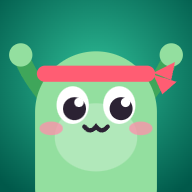
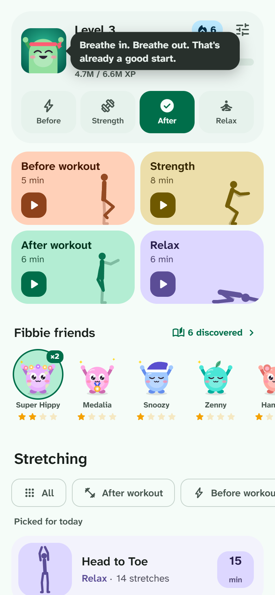
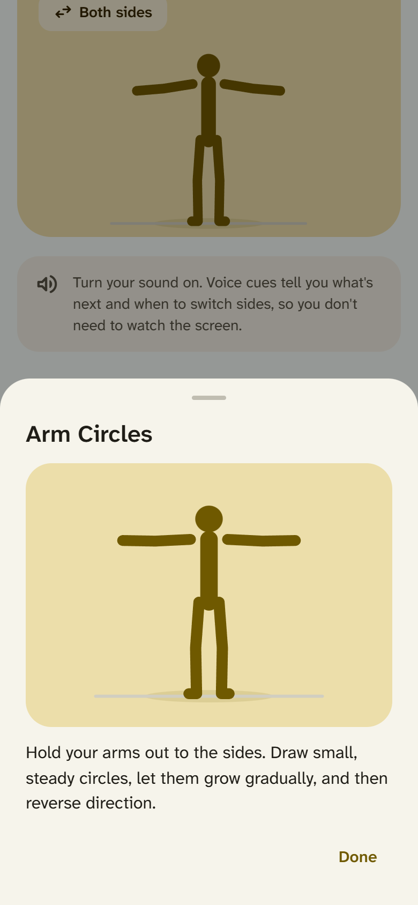
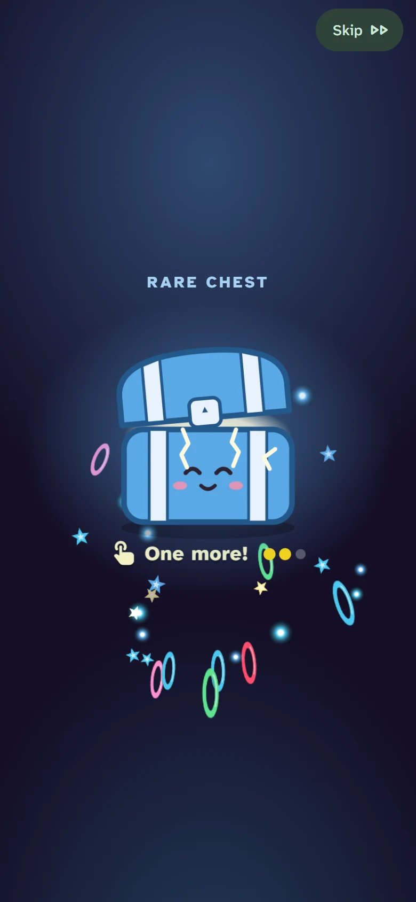
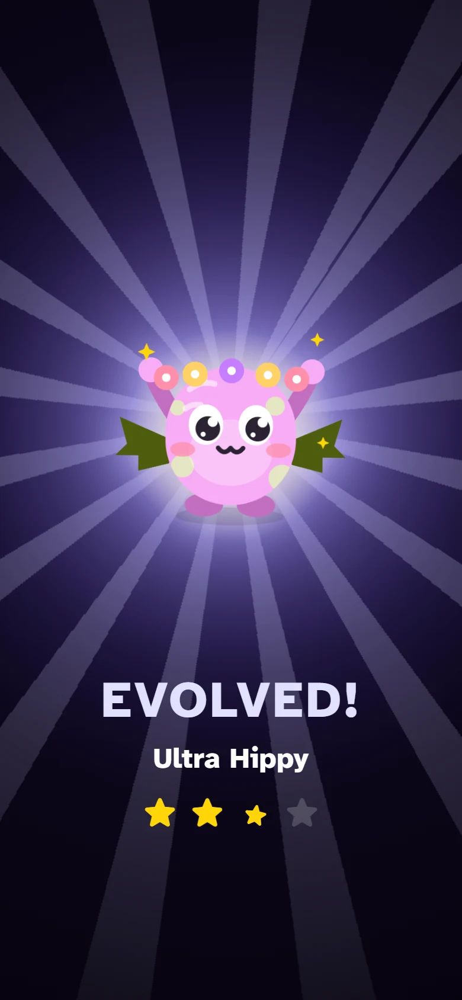

# Fibbies

**Stretch a little. Build a little strength.**

Follow short guided routines to warm up, stretch, or build strength. Open chests, collect little Fibbies, and come back to a fresh thought from the Fibbie on your home screen.

**[Try Fibbies in your browser](https://fibbies.juringari.com/)** · [Android APK](https://github.com/slovenec88/fibbies/releases/latest) · [Project page](https://juringari.com/fibbies/)

## How it works

### Meet the routines

Take a 2-Minute Reset at your desk, warm up before a run, try a strength routine for your feet and arches, or get your heart racing with a 20-minute HIIT, no equipment needed. Tap any exercise in a routine to see how it moves and read a short guide in your language before you start.

### Follow the stretch

[An animated figure](docs/screenshots/guided-session.png) shows each move and a timer keeps you on pace. Spoken cues tell you when to start, switch sides, or move on. You can pause or skip ahead, and **Session length** in Settings adjusts both stretches and strength exercises.

### Open a chest

Your first warm-up, cooldown, evening routine, and strength session each earn a chest that day. Chests get better as you try more kinds of routines. Tap three times to see what’s inside. Quick resets and repeat routines still earn fibers and XP. Tap the fiber knot three times to loosen it and watch its face light up.

### Collect and evolve

Find original Fibbies and wild ones with different shapes, colors, and faces. The [album](docs/screenshots/album.png) tracks your discoveries. Merge two matching Fibbies at the same stage to see their next form.

## Make it yours

- The Fibbie beside your XP blinks, waves, and stretches. Tap it to hear a soft sound and see a kind thought in your language.
- Build a streak, level up, and track changes with the [weekly flexibility check](docs/screenshots/flexibility.png).
- Install Fibbies from your browser for offline use, or download the signed Android APK from GitHub Releases.
- Use the app and spoken guidance in English, German, Spanish, French, Italian, Portuguese, or Slovenian.
- Your progress stays on your device. Copy a backup code in Settings to move it between devices.

## The code

See [DEVELOPING.md](DEVELOPING.md) to run Fibbies locally, [RANKINGS.md](RANKINGS.md) for the stretch rankings, and [GitHub Issues](https://github.com/slovenec88/fibbies/issues) to report a problem or share an idea.

Fibbies was created by **Davor Val Vega**. It's free and open source under the [GNU Affero General Public License v3.0 only](LICENSE). You may use, change and share it, but any copy or changed version must stay open source under the same licence, including versions run as a website, and must keep this credit (see [NOTICE](NOTICE)).

*Fibbies is a general wellness app, not medical advice. If you're injured or recovering, ask a doctor or physio before stretching.*
