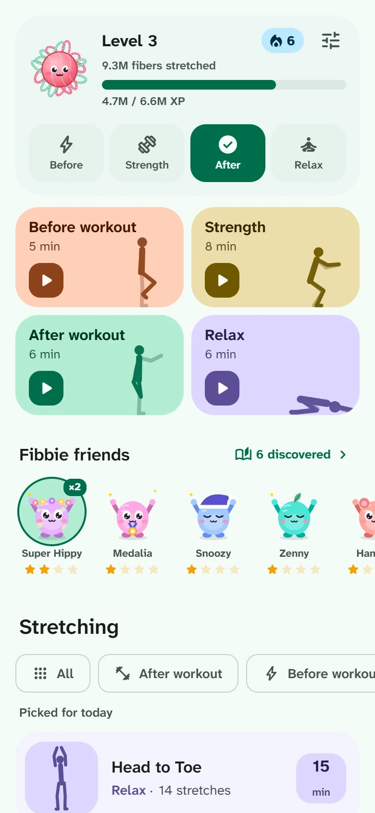
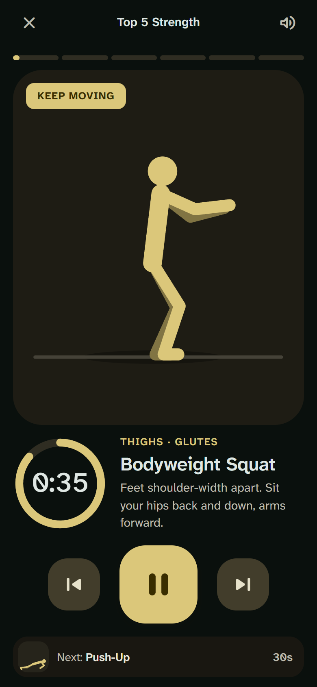
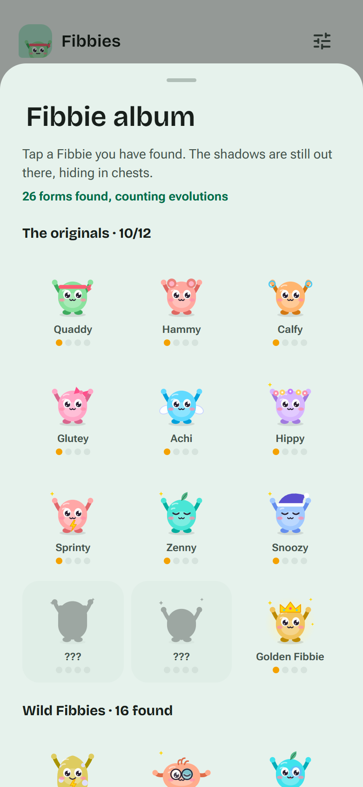
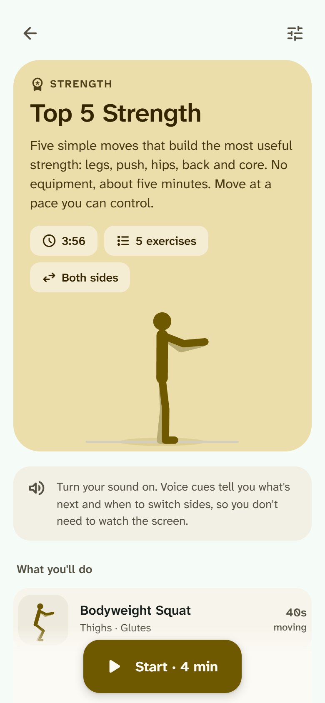
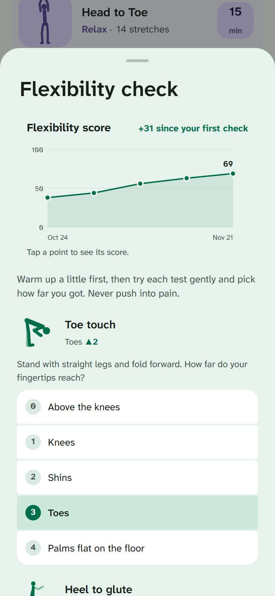

# Fibbies

**Stretch for a few minutes. Open a chest. Collect a critter.**

A follow-along stretching app for before and after a workout, at bedtime and during a work break, with a treasure chest at the end of every session.

**[Try Fibbies in your browser →](https://fibbies.juringari.com/)** · [Project and Android updates](https://juringari.com/fibbies/)

&nbsp;
&nbsp;

## Stretching that's easy to keep doing

Most people know they should stretch, and most skip it. Fibbies makes it short, guided and worth coming back to.

- **Press Start and follow along.** An animated figure shows each pose. A voice tells you what's next and when to switch sides, so you don't need to watch the screen. The screen stays on until you're done.
- **Two to ten minutes.** There are 14 routines for warming up, cooling down, winding down for bed, and quick breaks, including a 2-minute routine for busy days.
- **Stretches chosen by research.** Each group starts with a *Top 5* routine. Its stretches are ranked by how well they work and how simple they are, based on physical therapist and coaching advice ([see the rankings](RANKINGS.md)).
- **Desk-friendly.** The work-break stretches need no floor, no mat and no equipment. You can do them in office clothes next to your desk.

&nbsp;

## A reward every time

- **A treasure chest after every session.** Tap to open it and watch the counter of "muscle fibers stretched" spin up.
- **Multipliers stack up.** You get them for a daily streak, a perfect session, a lucky roll and *today's bonus*: each kind of routine you do in a day (warm-up, cool-down, evening wind-down) adds +25% to every chest for the rest of that day.
- **Chests come in four tiers,** from Wooden to Legendary. Most are Wooden, so a Legendary one feels special. Streaks and a big daily bonus improve your odds.
- **Skipping doesn't pay.** Sessions less than half done earn nothing.

## Meet the Fibbies

- **Every chest holds a Fibbie,** a little critter drawn by code. There are 12 originals to find and an endless number of wild ones, so a chest can hold one nobody has seen.
- **Merge two of the same Fibbie** to evolve it through four stages, with a big show at each evolution.
- **Fill the album.** The originals you haven't found yet show up as shadows.
- **Some Fibbies are shy.** Now and then one runs off before you can catch it.

## See your progress

- **Weekly flexibility check:** four quick self-tests (both sides where it matters) give you a score and a chart over time.
- **Streaks and levels:** a day streak, a weekly tracker, XP levels and daily quests.
- **Your progress stays yours.** It's saved in your browser or on your Android device, with no account and no tracking. You can copy a backup code to move it between devices. Cloud save through Google Play Games is on the way for the Android app.

## Made for phones

- **Material You design** in light and dark mode, with 8 colours to choose from.
- **Works offline.** Install it to your home screen as a web app, or use the Android app.
- **7 languages,** spoken cues included: English, German, Spanish, French, Italian, Portuguese and Slovenian.
- **Safety first:** a short note on how to stretch safely, and hold lengths you can change. *Flex 60s* mode stretches every still hold to 60 seconds a side when you're working on flexibility.

---

Building or contributing? See [DEVELOPING.md](DEVELOPING.md). Ideas for what's next are in [TODO.md](TODO.md).

Fibbies was created by **Davor Val Vega**. It's free and open source under the [GNU Affero General Public License v3.0 only](LICENSE). You may use, change and share it, but any copy or changed version must stay open source under the same licence, including versions run as a website, and must keep this credit (see [NOTICE](NOTICE)).

*Fibbies is a general wellness app, not medical advice. If you're injured or recovering, ask a doctor or physio before stretching.*
